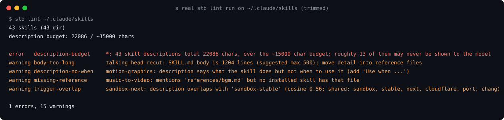

# skill-trigger-bench

Find out which of your skills Claude never uses.

[](https://github.com/TanbirRamim/skill-trigger-bench/actions/workflows/ci.yml) [](https://github.com/TanbirRamim/skill-trigger-bench/actions/workflows/skills.yml) [](LICENSE)

Try it on your own skills, nothing to install first:

```sh
uvx --from git+https://github.com/TanbirRamim/skill-trigger-bench stb lint ~/.claude/skills
```

What it printed on my machine (trimmed):

```
43 skills (43 dir)
description budget: 22086 / ~15000 chars

error   description-budget     *: 43 skill descriptions total 22086 chars, over the ~15000 char budget; roughly 13 of them may never be shown to the model
warning trigger-overlap        sandbox-next: description overlaps with 'sandbox-stable' (cosine 0.56; shared: sandbox, stable, next, cloudflare, port, chang)

1 errors, 15 warnings
```



You wrote a skill. The description looks right. Claude still doesn't use it, and nothing tells you it was skipped:

- Skill descriptions share a budget of roughly 15k characters. Install enough skills and some are silently never shown to the model.
- Overlapping skills compete for the same prompts, so the one you wanted loses.

Installing just the top 3 public skill packs together (counting only the hand-written Composio skills) puts you at 138% of that budget ([State of public skills](docs/state-of-skills.md)).

`stb` gives you two things: a free offline lint of your whole installed set, and a small
live eval that actually runs prompts through the agent and counts how often it reaches
for your skill.

## Install

Python 3.10+, no dependencies (PyYAML is used if it's there). Not on PyPI yet, so straight from GitHub:

```sh
pipx install git+https://github.com/TanbirRamim/skill-trigger-bench   # or: uv tool install git+https://...
```

Or from a clone:

```sh
git clone https://github.com/TanbirRamim/skill-trigger-bench && cd skill-trigger-bench
pipx install .        # or: uv tool install .
stb --version
```

## GitHub Actions

Lint skills in CI with the composite action. It installs Python and `stb` from the action repository, then reports findings as GitHub annotations:

```yaml
- uses: TanbirRamim/skill-trigger-bench@v0
  with:
    paths: skills/
    strict: true
```

The optional inputs are `paths` (defaults to `.`), `strict` (defaults to `false`), `ignore` (comma-separated rule names), `budget` (defaults to `15000`), and `overlap` (defaults to `0.35`). The action exits with the `stb lint` status, so errors fail the workflow step.

## stb lint

```sh
stb lint                      # ~/.claude/skills, ./.claude/skills, installed plugin skills
stb lint path/to/skills       # any folder of SKILL.md folders, or one skill
stb lint --format json        # for scripts and CI
stb lint --format sarif       # SARIF 2.1.0 for GitHub code scanning
stb lint --strict             # warnings fail too
stb lint --suggest            # show a suggested fix under findings that have one (never edits files)
```

What it checks:

| rule | what it means |
|---|---|
| `frontmatter`, `name-*`, `description-missing`, `description-length` | the [Agent Skills spec](https://agentskills.io/specification): name ≤ 64 chars, lowercase-hyphen, matches its folder; description present and ≤ 1024 chars |
| `description-no-when` | the description says what the skill does but never when to use it |
| `description-point-of-view` | the description is written in first or second person instead of third |
| `description-filler-start` | the description wastes characters on a filler start like "This skill..." instead of leading with the task |
| `description-budget` | all descriptions together are over (or near) the ~15k char budget (`--budget` to change) |
| `trigger-overlap` | two descriptions are similar enough (TF-IDF cosine ≥ 0.35, `--overlap`) that they'll fight over prompts; the shared terms are listed |
| `duplicate-name` | the same skill name installed twice, e.g. from two plugins |
| `body-too-long` | SKILL.md body over 500 lines |
| `missing-reference` | a linked file doesn't exist (error), or a bare path like `references/x.md` exists in no installed skill (warning) |

Here's a real run on my machine, against the public skill packs I have installed
(Cloudflare's skills, HyperFrames, and the brag, resend and frontend-design plugins):

```
$ stb lint ~/.claude/skills/... <plugin skill dirs>
41 skills (41 dir)
description budget: 18852 / ~15000 chars

error   description-budget     *: 41 skill descriptions total 18852 chars, over the ~15000 char budget; roughly 10 of them may never be shown to the model
warning body-too-long          slideshow: SKILL.md body is 522 lines (suggested max 500); move detail into reference files
warning body-too-long          talking-head-recut: SKILL.md body is 1204 lines (suggested max 500); move detail into reference files
warning body-too-long          wrangler: SKILL.md body is 918 lines (suggested max 500); move detail into reference files
warning description-no-when    motion-graphics: description says what the skill does but not when to use it (add 'Use when ...')
warning description-no-when    music-to-video: description says what the skill does but not when to use it (add 'Use when ...')
warning description-no-when    pr-to-video: description says what the skill does but not when to use it (add 'Use when ...')
warning missing-reference      motion-graphics: mentions 'assets/index.md' but no installed skill has that file
warning missing-reference      music-to-video: mentions 'assets/bgm.mp3' but no installed skill has that file
warning missing-reference      music-to-video: mentions 'references/bgm.md' but no installed skill has that file
warning trigger-overlap        cloudflare: description overlaps with 'wrangler' (cosine 0.35; shared: work, cloudflare, ai, vectorize, r2, kv)
warning trigger-overlap        resend: description overlaps with 'resend-cli' (cosine 0.50; shared: resend, email, template, send, webhook, event)
warning trigger-overlap        sandbox-migrate-to-next: description overlaps with 'sandbox-next' (cosine 0.60; shared: sandbox, next, stable, 1.0, cloudflare, preview)
warning trigger-overlap        sandbox-migrate-to-next: description overlaps with 'sandbox-stable' (cosine 0.54; shared: sandbox, stable, next, cloudflare, 1.0, port)
warning trigger-overlap        sandbox-next: description overlaps with 'sandbox-stable' (cosine 0.56; shared: sandbox, stable, next, cloudflare, port, chang)
info    description-angle-brackets hyperframes-audio: description contains '<' or '>'

1 errors, 14 warnings
```

A few things this showed me that I hadn't noticed: I'm about 25% over the description
budget, so some of these skills are probably invisible to the model in every session; the
three Cloudflare Sandbox skills are near-copies of each other as far as matching goes; and
`resend` vs `resend-cli` is a coin flip for any "send an email" prompt.

The overlap score is lexical, not semantic. It catches the obvious collisions and misses
paraphrases. Treat it as a hint about where to look.

## stb eval

This one calls a model, so it costs money. Each prompt is one `claude -p` run.

```sh
stb eval path/to/my-skill --dry-run                    # print generated prompts, no calls
stb eval path/to/my-skill --prompts prompts.yaml --model haiku
stb eval path/to/my-skill --with path/to/other-skill   # install neighbours too, to test collisions
stb eval path/to/my-skill --prompts prompts.yaml --html report.html # generate standalone HTML report
```

How it works:

1. Prompts come from your file or are generated from the description. The generator is a
   dumb template filler (should-trigger from the description's own phrases, should-not from
   other skills and generic tasks). Write a prompt file for anything you care about:

   ```yaml
   should_trigger:
     - "What's in sales_2024.csv? Give me a quick overview of the columns."
   should_not_trigger:
     - "Write a haiku about autumn rain."
   ```

2. Each prompt runs in a fresh temp project with only the chosen skills in
   `.claude/skills`, using `--setting-sources project` so your own `~/.claude` skills and
   plugins aren't loaded (Claude Code's built-in skills still are, which is realistic).
   Tools that could change anything (Bash, Edit, Write, web) are turned off, and turns are
   capped at 2.
3. The `stream-json` transcript is parsed. A skill counts as activated only if there's a
   `Skill` tool call naming it. Reading the SKILL.md file by hand doesn't count.
4. You get a trigger rate and a false-trigger rate, and the exit code is 1 if they're
   outside `--min-trigger` (default 0.8) or `--max-false` (default 0.2).

A real smoke run against the example skill in this repo:

```
$ stb eval examples/skills/csv-summary --prompts examples/csv-summary.prompts.yaml --model haiku
[1/4] no   (should) What's in sales_2024.csv? Give me a quick overview of the columns.
[2/4] yes  (should) Can you profile this spreadsheet export for me: data/customers.csv
[3/4] no   (should not) Write a haiku about autumn rain.
[4/4] no   (should not) Convert this JSON object to YAML: {"a": 1, "b": [2, 3]}

csv-summary via claude
trigger rate:       50%  (want >= 80%)
false-trigger rate: 0%  (want <= 20%)
cost: $0.0726
  missed: What's in sales_2024.csv? Give me a quick overview of the columns.
FAIL
```

Four prompts is far too few to mean anything. It's there to show the shape. Model output
varies between runs, so use 10+ prompts per side before you trust a number.

### Runners

Pick one with `--agent` (alias `--runner`). They live in `src/skill_trigger_bench/runners.py`;
another agent is a subclass with a `run()` method.

- **`claude`** (default): `claude -p --output-format stream-json`. Activation is the
  explicit `Skill` tool call in the transcript.
- **`codex`**: `codex exec --json --sandbox read-only --ephemeral --ignore-user-config`,
  with `web_search="disabled"` and `approval_policy="never"`. Skills are copied into
  `<sandbox>/.agents/skills` and `HOME` points at the sandbox so your own
  `~/.agents/skills` don't leak in (`CODEX_HOME` stays real, for auth). Admin
  (`/etc/codex/skills`) and Codex's bundled skills can't be hidden.

  **Codex activation is a heuristic.** `codex exec --json` has no "skill used" event
  (the item types are `agent_message`, `reasoning`, `command_execution`, `file_change`,
  `mcp_tool_call`, `web_search`, `todo_list`, `error`, ...). Codex's docs say that when
  it picks a skill it reads the full SKILL.md, so `stb` counts a skill as activated when a
  `command_execution` item's command mentions `<skill>/SKILL.md`. That misses a skill used
  from its description alone, and would count a model that reads a SKILL.md for another
  reason.

  Status: the flags were checked against `codex exec --help` (codex-cli 0.160.0) and the
  event schema against the docs and `codex-rs/exec/src/exec_events.rs`. The parser tests use
  hand-written fixtures in that shape. **It has not been run live against a model yet**;
  if you do, a recorded transcript in an issue would help.
- **`gemini`**: `gemini -p --output-format stream-json`. Skills are placed into
  `<sandbox>/.gemini/skills`, and `GEMINI_CLI_HOME` is pointed at the sandbox so your
  global `~/.gemini` (skills, settings) stays out of it.
  Activation is detected from `tool_use` events for `activate_skill` (its `name`
  parameter), or heuristically when a tool reads `<skill>/SKILL.md`. The event schema
  was checked against `packages/core/src/output/types.ts` and
  `packages/core/src/tools/activate-skill.ts` in google-gemini/gemini-cli.
  **It has not been run live yet.**

## CI

`stb lint` exits 1 on errors (or on warnings with `--strict`), and `--format json` gives
you something to parse. `--format github` prints one workflow command per finding
(`::error`, `::warning`, `::notice` for info) for inline PR annotations, while `--format sarif` outputs SARIF 2.1.0 for GitHub code scanning. See [.github/workflows/skills.yml](.github/workflows/skills.yml):
lint runs on every PR that touches skills; eval is manual (`workflow_dispatch`) because it
needs an API key and costs money.

## Why

This is the most common complaint about Agent Skills right now:

- Skills don't auto-activate, and matching looks more like keyword overlap than meaning
  ([anthropics/claude-code#46952](https://github.com/anthropics/claude-code/issues/46952),
  with Scott Spence's measurements:
  [sandboxed evals](https://scottspence.com/posts/measuring-claude-code-skill-activation-with-sandboxed-evals),
  [skills don't auto-activate](https://scottspence.com/posts/claude-code-skills-dont-auto-activate)).
- A personal skill never triggers even though the prompt matches its description
  ([anthropics/claude-code#21947](https://github.com/anthropics/claude-code/issues/21947)).
- Skill descriptions share a budget of roughly 15k characters. Install enough skills and
  some are silently never shown to the model
  ([fsck.com, "Claude Code skills not triggering"](https://blog.fsck.com/2025/12/17/claude-code-skills-not-triggering/)).
- The trigger eval in skill-creator reports a 0% trigger rate for everything
  ([anthropics/skills#556](https://github.com/anthropics/skills/issues/556)), and the harness
  measures slash-command registration rather than auto-triggering
  ([anthropics/claude-code#79998](https://github.com/anthropics/claude-code/issues/79998)).
- Overlapping plugins install near-duplicate skills that compete for the same prompts
  ([anthropics/skills#189](https://github.com/anthropics/skills/issues/189)).

## How is this different from `claude plugin eval` and `/skill-doctor`?

Claude Code now ships both, and if you only use Claude Code and care about one skill at a
time, start there. `stb` is aimed at the gaps:

- **The whole installed set.** Overlap and budget are problems between skills, not inside
  one. `stb lint` looks at everything you have installed together, across
  `~/.claude/skills`, the project, and plugins.
- **Not tied to one agent.** SKILL.md is a shared format, and the eval runner is a plugin
  point so the same prompt files can be run against other agents. Claude Code and Codex CLI
  runners exist today; the Codex one detects activation heuristically (see Runners).
- **CI-first.** Plain exit codes, JSON output, no interactive session needed.

## Use it from your agent

[skills/skill-trigger-bench/SKILL.md](skills/skill-trigger-bench/SKILL.md) is a skill that
teaches the agent to run `stb lint` and explain the findings, and to ask before running
`stb eval`. Copy that folder into `~/.claude/skills/`.

## Development

```sh
PYTHONPATH=src python3 -m unittest discover -s tests -t .
uvx ruff check . && uvx ruff format --check .
```

The tests never call a model. Stream parsing is tested against real `claude -p`
transcripts recorded once and scrubbed (`tests/fixtures/`).

## License

MIT

## Contributors

- [@CRYPTONIKAV](https://github.com/CRYPTONIKAV): `--format github` annotations (#10), the `description-point-of-view` rule (#11), more eval templates and near-miss negatives (#12)
- [@Pranitha06sri](https://github.com/Pranitha06sri): `stb lint --suggest` (#14)
- [@yesheng-oss](https://github.com/yesheng-oss): GitHub Action wrapper (#17)
- [@chiragjangiir](https://github.com/chiragjangiir): the `description-filler-start` rule (#19), SARIF output (#21)

## Also by me

[show-receipts](https://github.com/TanbirRamim/show-receipts) blocks an agent's "tests pass" claim when no test actually ran. [Open Source Radar](https://github.com/TanbirRamim/open-source-radar) lists good first issues from active projects that nobody has claimed yet, plus a guide for first PRs.
